

# NalburPOS

### Nalbur, Hırdavat ve Yapı Marketler İçin Dokunmatik Kasa, Stok ve Veresiye Sistemi

**Tezgahta sıra bekletmeyen satış hızı, kilogram/metre/kutu dönüşümlü stok takibi, tek dokunuşla usta indirimi ve şeffaf veresiye yönetimi.**

 

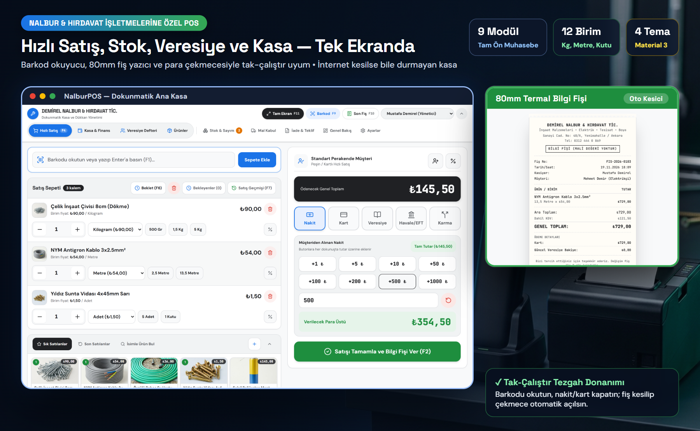

---

## İçindekiler

- [İşletmenize Ne Kazandırır?](#işletmenize-ne-kazandırır)
- [Canlı Hızlı Satış Akışı](#canlı-hızlı-satış-akışı)
- [Tüm Özellikler (Ekran Ekran)](#tüm-özellikler-ekran-ekran)
- [Uyumlu Kasa Donanımları](#uyumlu-kasa-donanımları)
- [Kısayol Tuşları](#kısayol-tuşları)
- [Özellik Kontrol Listesi](#özellik-kontrol-listesi)
- [İletişim](#iletişim)

---

## İşletmenize Ne Kazandırır?

Nalbur satışları sıradan market programlarına sığmaz: çiviyi kilogram veya gramla, kabloyu metreyle, vidayı hem adet hem kutu olarak satarsınız; ustaya özel indirim uygular, yarım kalan sepeti bekletip sıradaki müşteriyi geçirirsiniz. NalburPOS bu çalışma düzenine göre geliştirildi.

| Avantaj | NalburPOS ile fark |
| :--- | :--- |
| **Saniyeler içinde satış** | Barkodu okutun veya fotoğraflı sık satılan kartlara dokunun; nakit, kart, veresiye ya da karma ödemeyi tek dokunuşla kapatın. |
| **Çoklu birim dönüşümü** | Aynı ürünü `Adet`, `Kutu`, `Koli`, `Kilogram`, `Gram`, `Metre`, `Litre`, `Rulo`, `Makara` veya `Takım` olarak satın; stoktan doğru miktar otomatik düşer. |
| **Şeffaf usta & genel indirim** | Ürün satır indirimleri önce düşülür; ustaya tanımlı indirim (%) kalan tutar üzerinden hesaplanır ve fişte ayrı satır olarak görünür. |
| **Veresiye & cari takip** | Usta, müteahhit ve firma borçları, kredi limiti uyarıları, kısmi tahsilatlar ve yazdırılabilir cari ekstre. |
| **Tak-çalıştır donanım** | Barkod okuyucu, 58/80 mm kesicili termal yazıcı, para çekmecesi, EFT-POS, terazi ve etiket yazıcısı desteği. |
| **Personel yetkilendirme** | Her personelin hangi ekranları göreceğini ve hangi işlemleri yapabileceğini tek tek belirleyin. |
| **İnternet kesilse de kasa durmaz** | Veriler cihazınızda saklanır; satış ve stok takibi kesintisiz sürer, tek tıkla yedek alınır. |

---

## Canlı Hızlı Satış Akışı

Sık satılan ürünlere dokunun, `1,5 Kg` gibi hazır birim seçin, banknot tuşlarıyla para üstünü görün ve bilgi fişini anında alın.

  

---

## Tüm Özellikler (Ekran Ekran)

> Uygulamanın herhangi bir ekranında gördüğünüz **fiş numarasına (`FIS-...`) tıkladığınızda** bilgi fişi önizleme ve yazdırma penceresi açılır.

### 1. Hızlı Satış Kasası

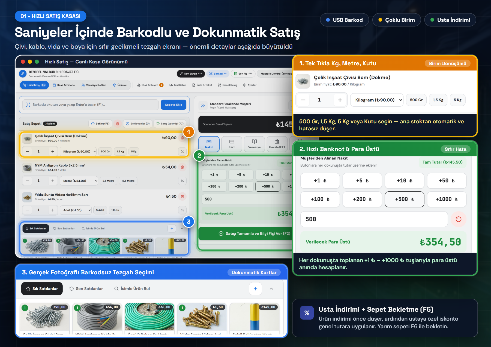

- Barkod okutarak veya ürün adıyla arayarak sepete ekleme
- Gerçek ürün fotoğraflı, dokunmatik **sık satılan ürünler**
- Hazır miktar/birim tuşları: `500 Gr`, `1,5 Kg`, `2,5 Metre`, `1 Kutu` ve serbest miktar girişi
- Ürün satırında birim değiştirme ve satır indirimi
- **Usta / müşteri seçimi** ile otomatik usta indirimi (%)
- Sepete **genel indirim** (tutar veya yüzde) ve düz hesap yuvarlama
- **Sepet bekletme** ve bekleyen sepetlerden devam etme; satış geçmişi penceresi
- Karma ödeme: nakit + kart + veresiye bir arada
- Kümülatif artan hızlı nakit banknot tuşları (`+1 ₺` – `+1000 ₺`) ve anlık para üstü
- Stok yetersizse uyarı penceresi
- Listede olmayan ürün için **hızlı ürün ekleme**
- Sanal barkod okuyucu (kamerasız test/okutma çekmecesi)
- Tam ekran kasa modu ve kısayol tuşları

### 2. Bilgi Fişi ve Barkod/Raf Etiketi

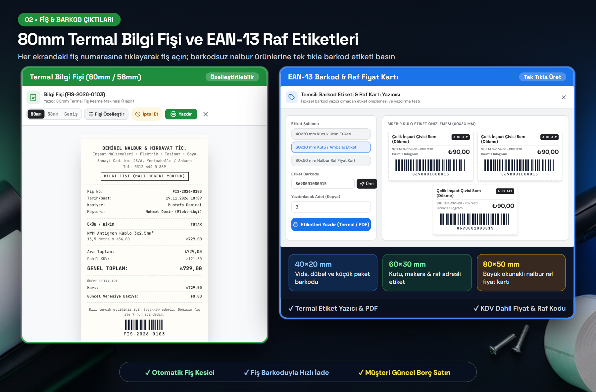

- 58 mm / 80 mm termal fiş şablonu; mağaza başlığı, telefon, KDV detayı, alt notlar düzenlenebilir
- Fişte ürün indirimi, usta indirimi, genel indirim ve müşterinin güncel veresiye bakiyesi
- Fiş barkodu ile fişi sonradan okutup bulma
- **EAN-13 barkod üretimi** (barkodsuz ürünler için tek tıkla)
- Raf fiyat etiketi: `40×20`, `60×30`, `80×50` mm

### 3. Kasa & Finans, Gün Sonu

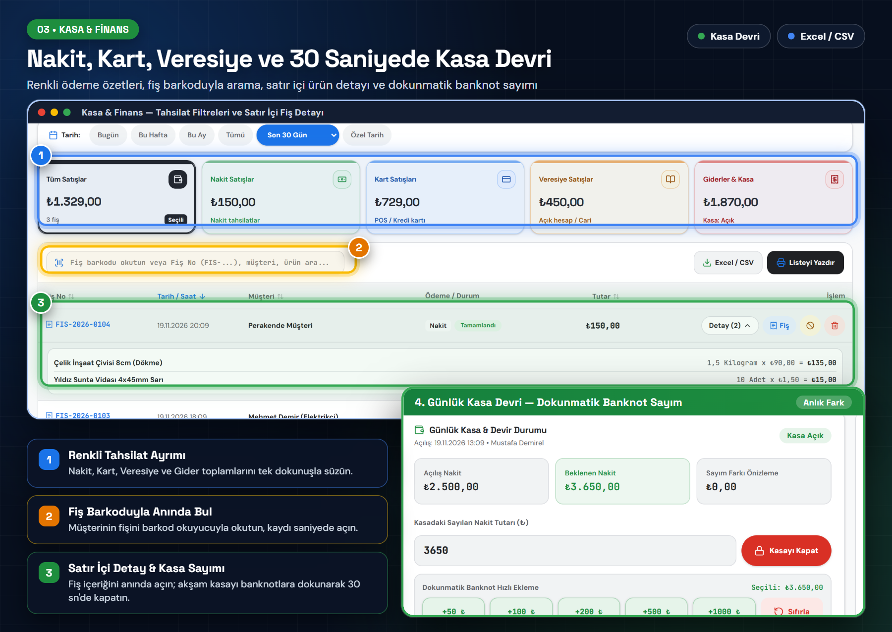

- `Tüm Satışlar`, `Nakit`, `Kart`, `Veresiye` ve `Giderler & Kasa` filtreleri
- Tarih aralığı filtresi ve sayfalama
- Fiş barkoduyla arama, satır içi ürün detayı, yazdırma ve iptal
- Gider ve kasa hareketi girişi
- Excel/CSV dışa aktarma
- **Dokunmatik banknot sayımı** ile beklenen nakit–sayılan nakit farkı

### 4. Veresiye Defteri & Cari Detay

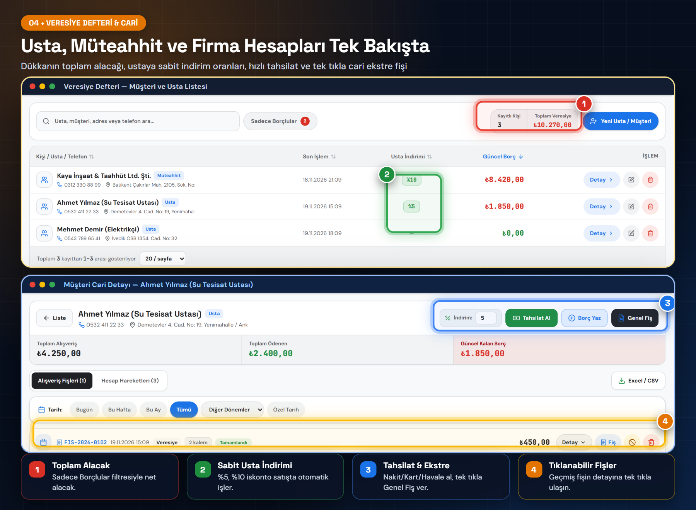

- Usta, müteahhit ve firma kartları (telefon, adres, not)
- Müşteriye sabit **usta indirimi (%)** ve **kredi limiti**; limit aşımı uyarısı
- `Sadece Borçlular` filtresi ve toplam dış alacak
- Nakit, kart veya havale ile **kısmi/tam tahsilat**
- Müşteri bazlı geçmiş satışlar (tıklanabilir fişler)
- Tek tıkla **genel hesap ekstresi** yazdırma

### 5. Ürün Kataloğu

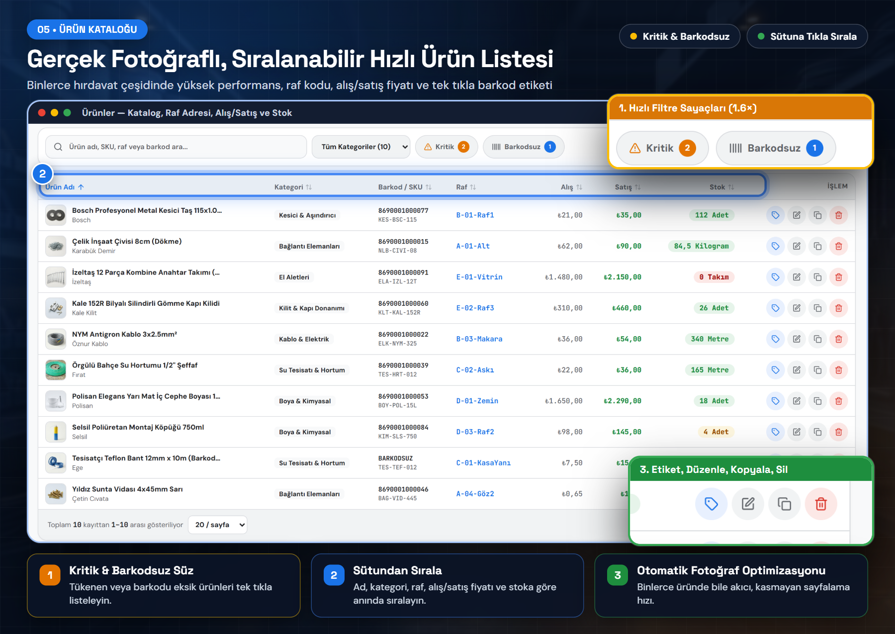

- Sütun başlığından sıralanabilir, sayfalı, hızlı ürün listesi
- **Kritik stok** ve **barkodsuz ürün** sayaçlarıyla tek tıkla filtre
- Alış/satış fiyatı, KDV, raf adresi, kategori, birim ve çoklu birim dönüşümü
- Ürün fotoğrafı (otomatik küçültülüp sıkıştırılır)
- Ürün kopyalama, düzenleme, onaylı silme
- **Toplu güncelleme** (fiyat/kategori gibi alanları birden çok üründe)
- Tek tıkla barkod etiketi basma

### 6. Barkodlu Stok Sayımı

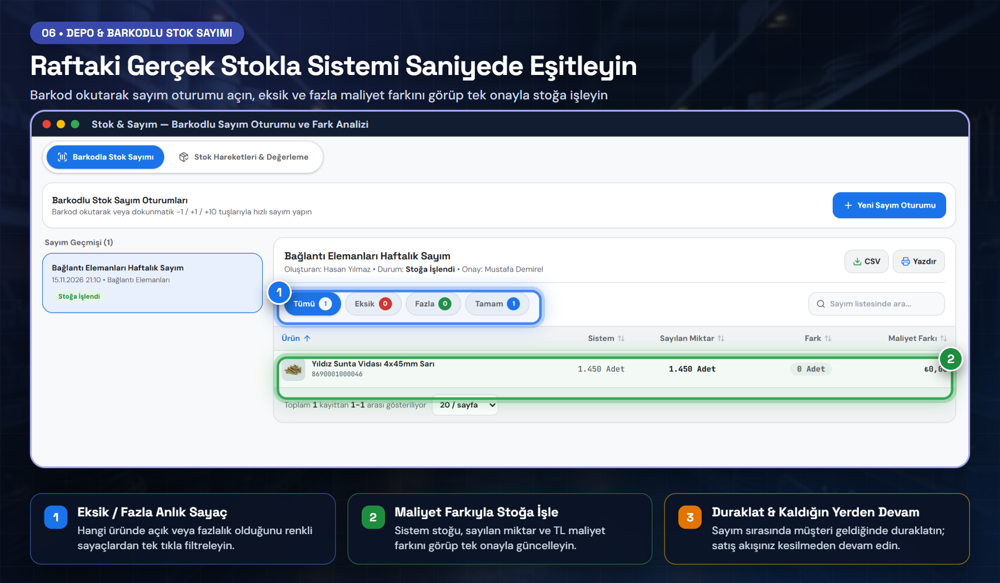

- Kategori bazlı sayım oturumu, barkod okutarak sayım artırma
- Sayımı duraklatıp kaldığı yerden devam etme
- Sistem stoğu ile sayılan arasındaki **eksik/fazla maliyet farkı**
- Tek onayla farkı stoğa işleme
- Stok hareketleri ve manuel stok düzeltme

### 7. Mal Kabul, Tedarikçi, Teklif ve İade

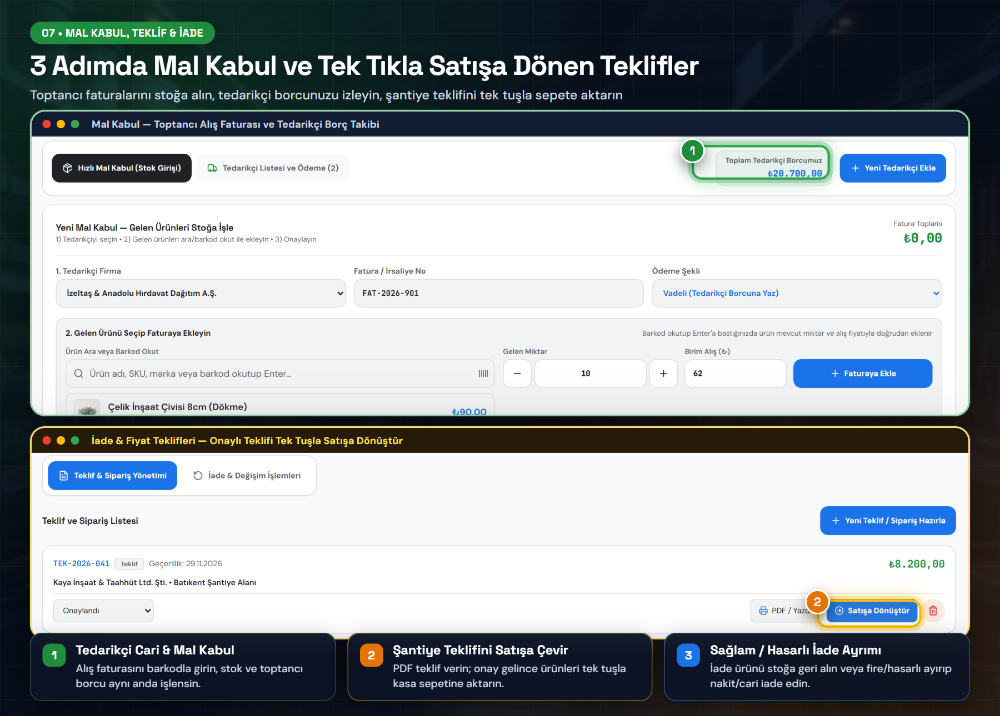

- **Mal kabul:** toptancı faturasını barkodla stoğa alma
- **Tedarikçi carisi:** toptancı borç/ödeme takibi
- **Fiyat teklifi:** yazdırılabilir şantiye teklifi; onayda tek tuşla kasa sepetine aktarma
- **Müşteri iadesi:** sağlam iadeyi stoğa geri alma, hasarlı/fire ayırma; nakit ya da veresiye hesabından düşme

### 8. Genel Bakış

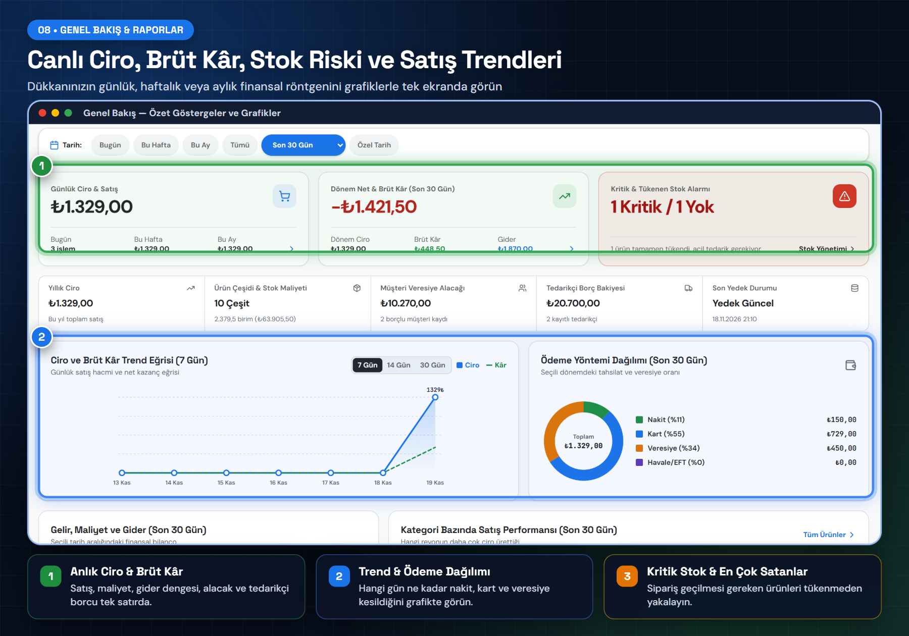

- Tarih filtreli ciro, brüt kâr ve gider dengesi
- Kritik/tükenen stok uyarıları
- Veresiye alacağı ve tedarikçi borç özeti
- Ciro–kâr trend grafiği, ödeme yöntemi dağılımı, kategori performansı

### 9. Donanım Yönetimi

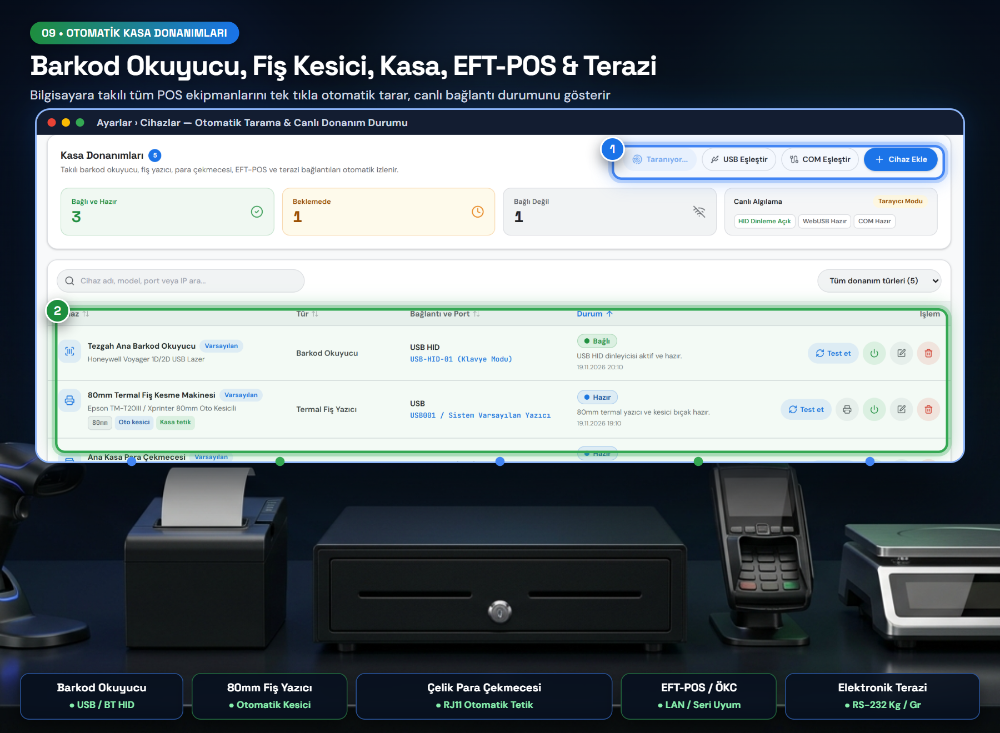

- Barkod okuyucu, termal yazıcı, para çekmecesi, EFT-POS/ÖKC, terazi, etiket yazıcısı ve müşteri ekranı için **otomatik cihaz tarama**
- Canlı durum rozetleri (`Bağlı`, `Hazır`, `Beklemede`)
- Anlık barkod okutma doğrulaması
- Tek tıkla **test fişi** yazdırma
- Sıralanabilir cihaz listesi

### 10. Personel Yetkilendirme ve Satış Performansı

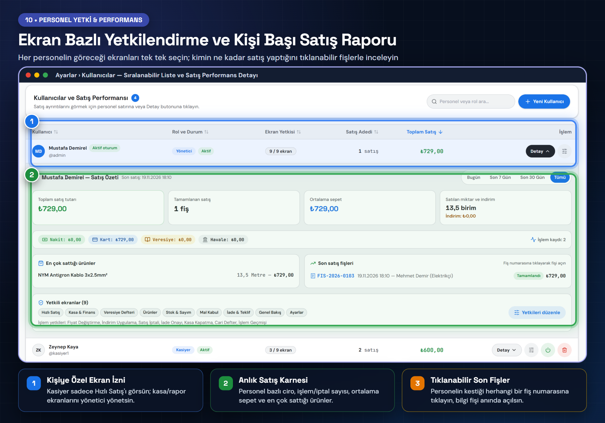

- Personel başına **görünür ekran** seçimi (ör. yalnızca Hızlı Satış)
- Kritik işlem yetkileri: iptal, iade, indirim, fiyat değiştirme, kasa kapatma
- Sıralanabilir personel listesi
- **Satış performans detayı:** dönemlik ciro, işlem/iptal sayısı, ortalama sepet, ödeme dağılımı, en çok satılan ürünler, tıklanabilir son fişler

### 11. Temalar, Sesler ve Yedekleme

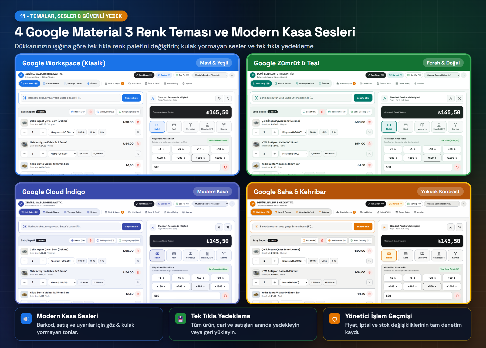

- **4 Material 3 teması:** Google Workspace (Klasik), Zümrüt & Teal, Cloud İndigo, Saha & Kehribar
- Kasa ve barkod ses efektleri (açılıp kapatılabilir)
- Tek tıkla **veri yedeği** indirme ve geri yükleme
- Yöneticiye özel tam **işlem geçmişi (denetim kaydı)**

---

## Uyumlu Kasa Donanımları

| Donanım | Destek |
| :--- | :--- |
| **1D / 2D Barkod Okuyucu** | USB ve Bluetooth tak-çalıştır; barkod kutusu seçili olmasa da otomatik okutma |
| **58 mm / 80 mm Termal Yazıcı** | USB, Ethernet (LAN) veya Bluetooth; otomatik kesici, özelleştirilebilir şablon |
| **Para Çekmecesi** | Yazıcı RJ11 portu veya seri bağlantı; nakit satışta otomatik açılma |
| **EFT-POS / Yeni Nesil ÖKC** | Yerel ağ (LAN/IP) veya seri port |
| **Elektronik Terazi (Kg / Gr)** | RS-232 / COM bağlantılı tartılar |
| **Barkod & Raf Etiket Yazıcısı** | Ürün ve raf fiyat etiketi basımı |
| **Müşteri Gösterge Ekranı (VFD)** | Anlık tutar ve para üstü gösterimi |

---

## Kısayol Tuşları

| Tuş | İşlev | Tuş | İşlev |
| :--- | :--- | :--- | :--- |
| `F1` / `F4` | Barkod girişine odaklan | `F8` | Genel indirim / düz hesap |
| `F5` | Müşteri / usta seçimi | `F9` | Barkod test çekmecesi |
| `F6` | Sepeti beklemeye al | `F10` | Son bilgi fişini aç |
| `F7` | Satış geçmişi ve bekleyen sepetler | `F11` / `ESC` | Tam ekran kasa modu aç / kapat |

---

## Özellik Kontrol Listesi

- [x] Dokunmatik ve barkodlu hızlı satış
- [x] Çoklu birim (adet, kutu, koli, kg, gr, metre, litre, rulo, makara, takım)
- [x] Satır, usta ve genel indirim
- [x] Karma ödeme (nakit / kart / veresiye)
- [x] Sepet bekletme ve satış geçmişi
- [x] Veresiye, kredi limiti, tahsilat ve cari ekstre
- [x] Termal fiş şablonu, tıklanabilir fiş numaraları
- [x] EAN-13 barkod üretimi ve raf etiketi
- [x] Ürün kataloğu, fotoğraf, toplu güncelleme
- [x] Barkodlu stok sayımı ve fark analizi
- [x] Mal kabul ve tedarikçi carisi
- [x] Fiyat teklifi ve tek tuşla satışa aktarma
- [x] Sağlam / hasarlı iade yönetimi
- [x] Kasa, gider, gün sonu banknot sayımı
- [x] Ciro, kâr ve stok grafikleri
- [x] Excel/CSV dışa aktarma
- [x] Otomatik donanım algılama ve test fişi
- [x] Personel ekran ve işlem yetkileri, satış performansı
- [x] 4 tema, ses efektleri
- [x] Yedekleme / geri yükleme ve denetim kaydı
- [x] İnternetsiz çalışma

---

## İletişim

Demo, fiyat ve kurulum için benimle iletişime geçebilirsiniz:

- GitHub: [@keminbtepe](https://github.com/keminbtepe)

**NalburPOS** — Hırdavat, nalburiye, elektrik, tesisat ve yapı market işletmeleri için.

